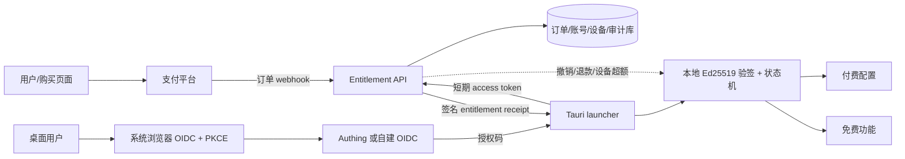

# 账号认证体系可行度与法律风险评估

- 评估日期：2026-07-26
- 产品：无限破甲 Windows Rust/Tauri launcher
- 范围：将现有 WJP1/CDK 激活迁移或升级为购买服务 + 账号认证 + 订阅授权
- 适用假设：主要面向中国大陆用户，同时保留少量境外用户
- 结论置信度：技术高；法律为产品上线前的合规工程判断，需执业律师复核具体主体与交易模式

## 0. 结论摘要

**建议采用“账号为主、签名授权票据为运行凭证、CDK 作为兼容/应急入口”的混合方案。**

账号认证适合解决：

- 订单与账号绑定
- 订阅到期、撤销、退款后的权限回收
- 多设备数量、异常登录、客服找回
- 登录审计、售后和版本化协议留存

账号认证本身不等于本地代码保密。当前 release 过程把付费 `reverse-skill.zip` 写入构建输出，Tauri 主程序再以 `include_bytes!` 嵌入 EXE；拥有客户端文件的人仍可提取资源或修改本地门禁。若目标是保护高价值能力，需要把高价值执行移到服务端，或采用按账号发放的加密资源；客户端解密后的内容仍属于本机可观测资产。

## 1. 证据链：Evidence → Finding → Path

### E-001 现有 CDK 验证质量较好

- Evidence：`crates/wujin-core/src/license.rs` 实现 WJP1、canonical JSON、Ed25519、产品/版本/字段严格校验。
- Verification：`cargo test -p wujin-core --test license_compat --test activation`，11 个 license 兼容测试与 4 个 activation 测试全部通过。
- Finding：防伪、篡改检测、版本约束属于成熟基础；核心短板是离线授权模型的管理能力。
- Path：保留公钥验签作为本地信任根，新增服务端签发的短期 entitlement receipt。

### E-002 付费 payload 直接嵌入客户端

- Evidence：`src-tauri/build.rs` 将 `WUJIN_PAYLOAD_PATH` 读取到 `OUT_DIR/reverse-skill.zip`；`src-tauri/src/main.rs` 通过 `include_bytes!` 载入 `EMBEDDED_PAYLOAD`。
- Finding：账号登录后即使本地接口门禁保持，付费资源仍随 EXE 分发；账号体系提升访问控制和运营能力，但对资源提取的改善有限。
- Path：第一阶段先做 entitlement 门禁；高价值能力逐步迁移到服务端或按账号发放的加密包。

### E-003 离线 CDK 没有服务器撤销语义

- Evidence：`ActivationStore::load` 只读取本地 activation.json 并重新验签；`require_paid_authorization` 只检查内存中的 `ActivationRecord.active`。
- Finding：退款、封禁、账号转移、设备超额等事件难以即时回收；CDK 共享仍缺少服务端证据链。
- Path：服务端维护 `user_id → order → plan → entitlement → device`，客户端定期拉取短期票据。

### E-004 试用期可通过删除/损坏缓存重新起算

- Evidence：`activation.rs:52-61` 在 `read_document()` 失败时将 `activated_at` 设为当前时间；现有测试覆盖篡改和回拨，未覆盖“删除缓存后再次激活同一 trial token”。
- Finding：trial 的可信起点当前依赖本地文件，适合兼容旧版但不适合商业试用控制。
- Path：把 trial 起点、兑换次数和订单状态放在服务端；本地只保存短期票据和最后可信时间。

### E-005 缓存写入不是 Windows 原子替换

- Evidence：`activation.rs:108-124` 先 `remove_file` 再 `rename`，崩溃窗口可能留下空缺。
- Finding：这属于可靠性/恢复问题，也会造成授权状态丢失。
- Path：使用同目录临时文件 + Windows `ReplaceFileW`/等价原子替换；保留旧文件回滚。

### E-006 当前账号与隐私落地面尚未形成

- Evidence：UI 只有 `activate_license(cdk)`；`launcher/config/links.json` 目前指向购买页和腾讯文档，源码中没有 OIDC callback、账号会话、订单 webhook 或 entitlement API。
- Finding：迁移需要新增服务端、登录回调、订单绑定和隐私工程，不是替换一个输入框。
- Path：先做独立 auth/entitlement service，再接 Tauri typed IPC。

### E-007 协议草案具备风险边界，但发布信息和隐私告知不完整

- Evidence：`无限破甲用户使用协议及免责条款-v2.txt` 首页仍有 `[生效日期]`、`[真实姓名或依法登记的经营主体全称]`、`[填写]`；账号化需要的隐私政策、处理者/受托方清单、数据保存期限、跨境路径、用户权利入口尚未单列。
- Finding：上线账号服务前，协议、隐私政策、购买页面和客户端留痕需要统一版本化。
- Path：主体信息、有效日期、隐私政策、退款/数字交付、账号暂停申诉和第三方服务清单全部定稿后再开放注册。

## 2. 技术可行度

| 方案 | 可行度 | 适用目标 | 主要代价 |
|---|---:|---|---|
| 继续纯离线 CDK | 7/10 | 低运营成本、离线场景 | 撤销、试用控制、设备数和售后弱 |
| 账号登录 + 服务端授权票据 + 本地缓存 | 9/10 | 当前产品最匹配 | 新增 API、数据库、运营和隐私义务 |
| 每次启动都在线鉴权 | 6/10 | 强控制、在线工具 | 断网体验差，服务故障直接影响付费功能 |
| 把全部高价值逻辑迁到云端 | 6/10 | 保护算法/内容 | 成本、延迟、数据安全和架构改造最大 |

**推荐：9/10 的混合方案。** 保留本地 Ed25519 验签；将 CDK 载荷升级为短期、可撤销、绑定账号和设备公钥的 entitlement receipt。在线检查周期建议 12–24 小时，服务故障保留 3–7 天 grace period；撤销或退款在下一次在线检查时生效。

## 3. 推荐架构

### 客户端边界

1. 使用系统浏览器 + Authorization Code with PKCE；Tauri 只保存 `state`/`nonce` 和短期 token，不嵌入 client secret。
2. 回调优先采用 `127.0.0.1` 随机端口，或受控的 `wujin://callback`；严格校验 `state`、`nonce`、issuer、audience、PKCE。
3. refresh token 放入 Windows Credential Manager/DPAPI；日志中只记录 hash/jti，邮箱、access token、refresh token、完整 CDK 均不进入日志。
4. UI 只触发 `login`、`refresh_entitlement`、`logout`；Rust service 层做 token 校验、票据缓存和付费门禁。
5. 保留现有免费 Skill 与更新状态机，更新检查继续和授权解耦。

### 服务端最小接口

- `POST /oauth/exchange`：交换授权码/PKCE，或直接使用 IdP token introspection
- `GET /v1/me`
- `GET /v1/entitlements`
- `POST /v1/devices/register`
- `POST /v1/entitlements/refresh`
- `POST /v1/orders/webhook`
- `POST /v1/admin/revoke`
- `POST /v1/admin/refund`
- `DELETE /v1/me`：账号与个人信息删除申请

receipt 建议字段：`sub`、`plan`、`features`、`device_key_id`、`iat`、`exp`、`jti`、`receipt_version`。不要把邮箱、手机号、订单备注放入客户端票据。

## 4. 服务选型

### 中国大陆优先

**Authing 身份云 + 自有 entitlement API** 是当前最快落地路径：

- 官方文档提供 OIDC/OAuth2 方案；适合桌面客户端通过系统浏览器完成登录。
- 官网当前显示免费计划最高 8,000 MAU，高级版页面标注 ¥1,299/月，企业版和私有云按销售报价；上线前以书面报价、SLA、数据处理条款为准。
- 适合把身份交给供应商，把订单、功能授权、设备和审计留在自己的服务端。
- 需确认租户数据存储地域、受托处理、转委托、备份、删除、审计导出和安全事件通知条款。

### 需要自控数据时

Keycloak/Zitadel 自建在中国大陆云主机：软件许可成本低、数据边界清晰，但需要自行承担升级、可用性、短信/邮件、监控、备份和安全响应。

### 境外用户优先

Auth0/Clerk/Supabase 等可作为海外区域 IdP；中国大陆用户接入前先完成跨境个人信息评估、单独告知与同意、供应商 DPA 和数据路径确认。不要把境外 IdP 当作默认无合规成本的方案。

## 5. 中国大陆法律与合规风险

### 高优先级

1. **个人信息保护法（PIPL）**
   邮箱、手机号、账号 ID、IP、设备公钥/设备标识、登录日志和订单关联数据属于个人信息处理范围。需要：
   - 单独、清晰的隐私政策，说明处理者主体、目的、字段、期限、供应商、用户权利和删除入口；
   - 账号认证、订单履行、反欺诈分别做目的和最小字段设计；
   - 与 Authing/云厂商签署委托处理条款并监督其处理；
   - 发生委托处理、敏感信息、跨境传输等情形前完成个人信息保护影响评估并留档；
   - 境外接收方涉及个人信息时，按 PIPL 第三十九条单独告知并取得单独同意。

2. **跨境数据**
   CAC《促进和规范数据跨境流动规定》（2024）给出了分级门槛：当年累计向境外提供不满 10 万人的非敏感个人信息通常免于申报安全评估；10 万至不满 100 万，或敏感个人信息不满 1 万，通常进入标准合同/认证路径；达到 100 万非敏感或 1 万敏感个人信息时进入安全评估路径。免于某项申报不等于免除告知、最小必要、安全保护和单独同意等义务。大陆首发建议优先选择境内存储或私有云。

3. **网络与数据安全**
   2025 年修订的《网络安全法》自 2026-01-01 起施行；同时适用《网络数据安全管理条例》（国务院令第 790 号）。需要做网络运营者安全管理、访问控制、日志、备份、事件响应和系统定级/等保判断；是否需要具体等保备案取决于系统功能、数据和主管部门定级，先做定级而非直接假设。

### 中优先级

4. **电子商务与消费者权益**
   购买页要明确经营主体、商品内容、许可期限、设备数、更新范围、交付方式、退款和数字化商品规则。永久授权应具体到版本/权益，不把停服、重大发布或退款条款写成绝对免责。数字化交付、下载/激活后的退款处理要在下单前显著提示并保留订单证据。

5. **格式条款与账号处置**
   风险提示、授权限制、账号暂停、设备限制、责任上限需要加粗/显著展示；账号冻结必须有触发条件、通知、申诉和退款/剩余权益处理，不用“一经封禁概不负责”覆盖所有情形。

6. **安全研究产品的供应商 AUP**
   该产品包含逆向、漏洞研究和自动化能力。购买身份服务前，取得供应商对安全研究工具、渗透测试内容、日志保留和高风险客户筛查的书面确认；否则存在账号/租户被暂停的运营风险。现有用户协议中的授权范围、第三方工具边界和知识产权限制应继续保留，但它们不替代平台 AUP 或法定义务。

## 6. 上线门槛

- [ ] 完成经营主体、网站/接口备案及支付/开票路径核验。
- [ ] 定稿《用户协议》《隐私政策》《退款与数字交付规则》《账号封禁与申诉规则》；替换草案中的占位符和占位日期。
- [ ] 建立数据地图：账号、订单、IP、设备 key、登录日志、entitlement、客服记录、第三方供应商、保存期限和删除流程。
- [ ] 完成供应商 DPA、地域、转委托、备份、删除、SLA、安全事件通知审查。
- [ ] 完成 OIDC PKCE、token rotation、DPAPI/Credential Manager、CSRF/state/nonce、证书链和重放防护测试。
- [ ] 完成 receipt 撤销、退款、设备超额、离线 grace、服务故障、时钟回拨、缓存损坏和卸载重装矩阵。
- [ ] 补充“删除 trial 缓存后再次激活同一 token”的回归测试。
- [ ] 修复 activation cache 的 Windows 原子替换。
- [ ] 对付费 payload 做“可提取性”红队验收；若目标是内容保密，迁移高价值执行或改为按账号加密分发。
- [ ] 埋点与日志脱敏；客服可查询订单/账号状态，但不接触原始 token。

## 7. 分阶段实施估算

| 阶段 | 结果 | 参考工期 |
|---|---|---:|
| P0 服务商尽调 + OIDC POC | 浏览器登录、回调、租户数据路径结论 | 2–4 个工作日 |
| P1 entitlement 后端 | 订单 webhook、计划、设备、撤销、receipt | 5–8 个工作日 |
| P2 Tauri 集成 | login/logout/refresh、DPAPI、离线 grace、状态机 | 4–7 个工作日 |
| P3 迁移与兼容 | 旧 CDK 兑换、账号绑定、客服工具、回滚 | 3–5 个工作日 |
| P4 合规与验收 | 协议/隐私、影响评估、等保定级、故障矩阵 | 5–10 个工作日 |

单人全栈约 3–5 周可完成首个可运营版本；服务商、支付 webhook、主体/备案或律师审查排队会拉长周期。

## 8. 最终决策

**可以购买账号认证服务并迁移。** 推荐先走：

1. Authing（境内公有云或私有云）做 OIDC 身份；
2. 自有小型 entitlement API 管订单、计划、设备、撤销；
3. 现有 WJP1 公钥验签保留，改验短期 entitlement receipt；
4. 旧 CDK 只作为兼容/找回通道，不再承载试用和撤销主逻辑；
5. 先完成隐私政策、数据处理合同和购买页改造，再开放账号注册。

若首要目标是“防止 EXE 被提取/破解”，账号服务不是充分措施；应同步调整付费 payload 的分发边界。

## 9. 参考来源

- [中华人民共和国个人信息保护法（中国人大网）](http://www.npc.gov.cn/npc/c2/c30834/202108/t20210820_313088.html)
- [促进和规范数据跨境流动规定（国家网信办）](https://www.cac.gov.cn/2024-03/22/c_1712776611775634.htm)
- [中华人民共和国网络安全法修改决定（中国政府网，2025）](https://www.gov.cn/yaowen/liebiao/202510/content_7046194.htm)
- [网络数据安全管理条例（国务院令第790号）](https://www.gov.cn/zhengce/zhengceku/202409/content_6977767.htm)
- [消费者权益保护法实施条例（国务院令第778号）](https://www.gov.cn/zhengce/zhengceku/202403/content_6940159.htm)
- [Authing OIDC 与 OAuth2.0 文档](https://docs.authing.co/v2/concepts/oidc/oidc-overview.html)
- [Authing 价格与部署方案](https://www.authing.cn/pricing)
- [RFC 8252 OAuth 2.0 for Native Apps](https://www.rfc-editor.org/rfc/rfc8252.html)
