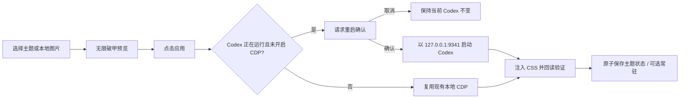

# 无限破甲 Codex 换肤集成验证

## 结果

- 上游固定为 `HeiGeAi/heige-codex-skin-studio` `v5.4.10` / `7712c1f4c34f7802e00d72900311d15242480995`，MIT 许可与文件哈希随资源包保留。
- 无限破甲内新增独立换肤页面、三个内置主题、自定义图片、恢复原生界面和可选常驻。
- 主题通过 `127.0.0.1:9341` 的 CDP 注入；不修改 `app.asar`、Codex 可执行文件或签名资源。
- 选主题只更新预览；真正应用必须点击独立按钮。检测到正在运行且尚未由无限破甲接管的 Codex 时，后端返回 `CODEX_RESTART_CONFIRM_REQUIRED`，界面取得明确确认后才会继续。

## 验证证据

- UI 全量测试：125/125 通过。
- Vite production build：通过。
- `wujin-skin`：19 个测试通过，覆盖主题哈希、引擎文件锁、CDP 端点、WebSocket 回读、生命周期回滚和自定义图片。
- `wujin-launcher` 换肤测试：3 个通过，覆盖嵌入资源安装、失败重装回滚和运行中 Codex 的重启确认门槛。
- Clippy：`wujin-skin --all-targets` 与 `wujin-launcher` 均以 `-D warnings` 通过。
- 只读环境检查：现有 Codex 根进程保持运行；`127.0.0.1:9341` 未监听。验证期间未执行真实注入、停止或重启 Codex。
